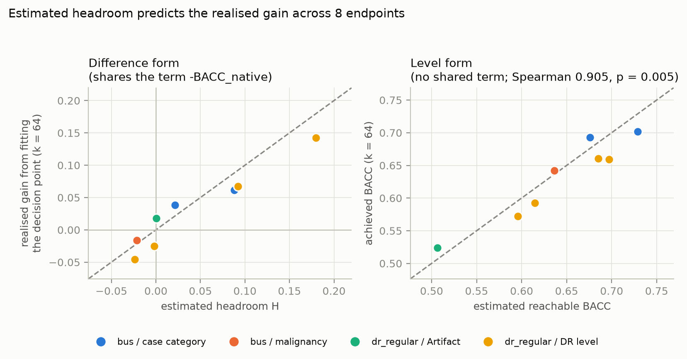
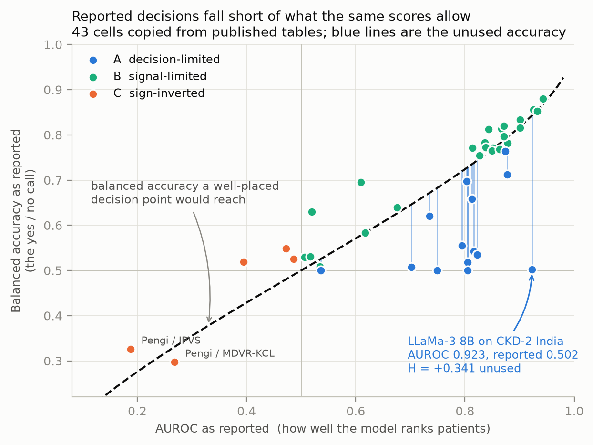
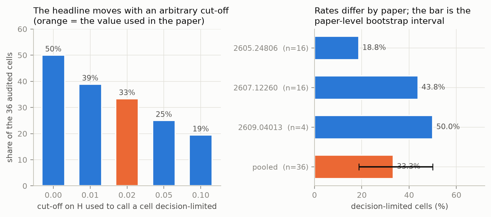
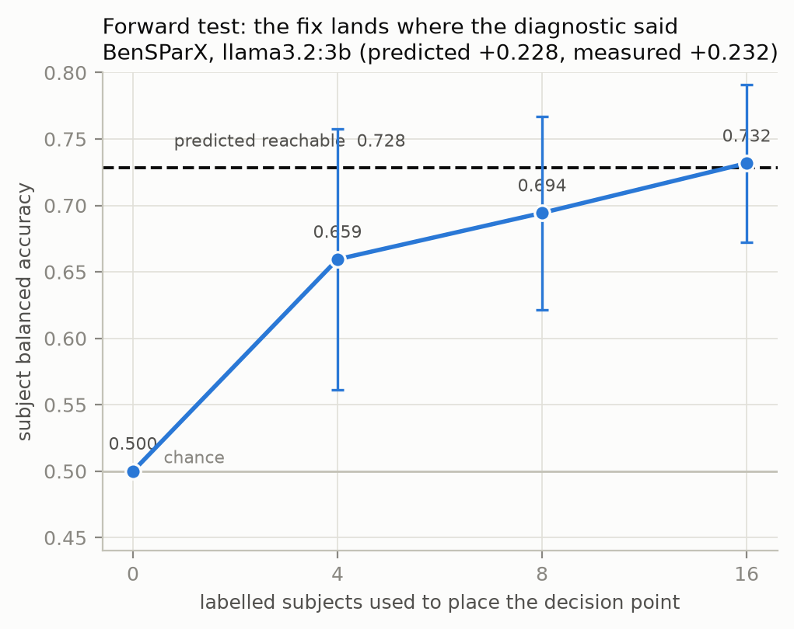
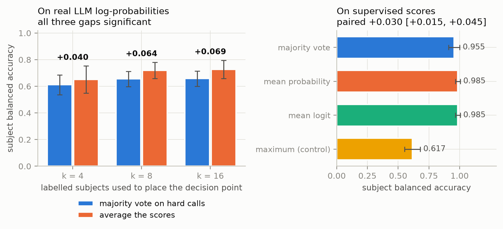
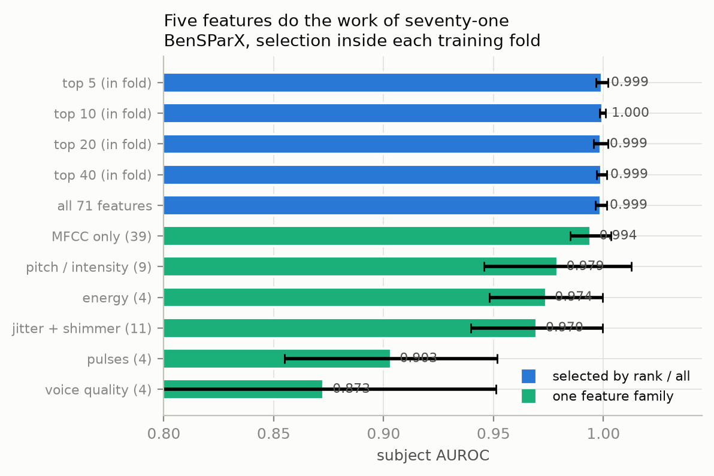
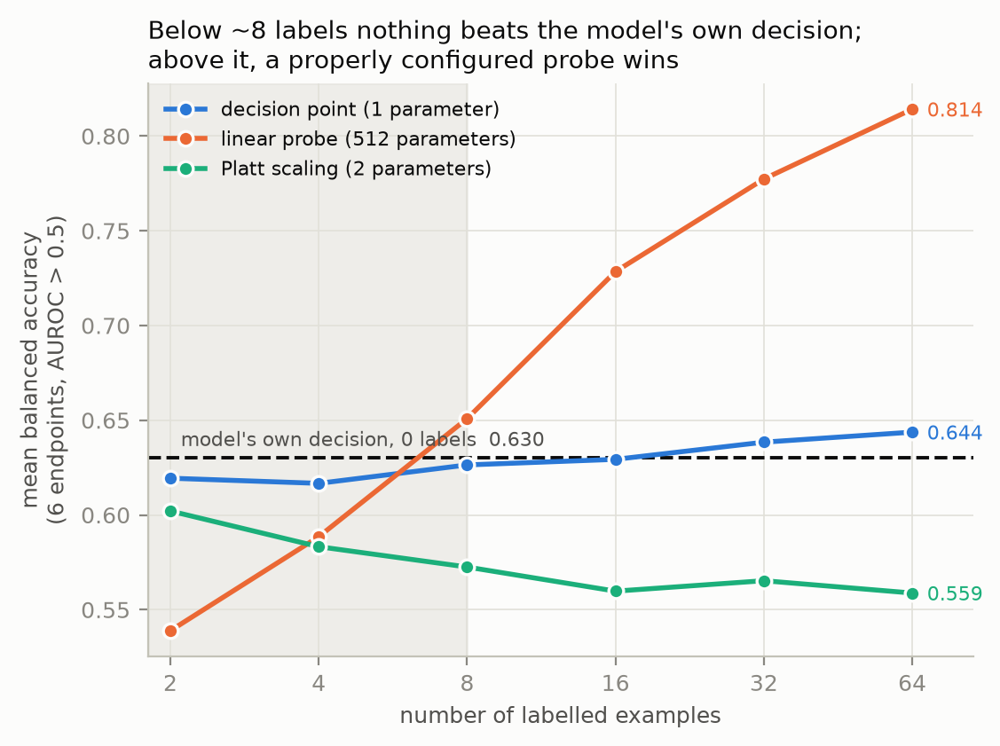

# Decision-Point Artifacts in Zero-Shot Clinical LLM Evaluation: An Audit and a Diagnostic

**Authors:** (to be completed)
**Version:** v2, 2026-10-14. The v1 manuscript is preserved at
`originals/draft_paper_v1_PRESERVED.md`; changes are listed in `CHANGELOG.md`.
**Target venue:** see Section 16.

---

## Abstract

Recent studies test large language models on clinical screening tasks without
training. The usual recipe forces the model to answer with one token, then scores
that answer. When the score is low, the study concludes the model cannot do the
task.

We show this conclusion is sometimes unsafe. A model does two separate jobs: it
ranks patients, and it draws a line to make a yes/no call. Ranking is measured by
AUROC, the call by balanced accuracy (BACC). These can fail separately. A forced
single token is one fixed, unchosen line, so a model that ranks well can still
report a near-chance BACC.

We estimate, from the AUROC a study already reports, the BACC a well-placed line
would give on the same scores, using the binormal model of signal detection
theory. We call the gap *headroom* (H). We verify the estimator by simulation: it
is exact under its own assumption and **under-estimates** when the two score
distributions have different spreads, so H is conservative.

We audit **36 result cells from 3 published papers**. In **12 of 36 cells (33%)**
the reported failure is consistent with a decision-point problem rather than a
ranking problem, with a mean of 0.138 BACC unused. The largest case is a model
ranking kidney-disease patients at AUROC 0.923 and reported at 0.502 BACC. These
figures describe the audited sample only. A bootstrap over papers gives
[18.8%, 50.0%], and the figure moves from 50% to 19% as the H cut-off moves from
0 to 0.10, so both are reported alongside it.

We then test the diagnostic forward on 8 image endpoints and on Bengali
Parkinson's speech. Across endpoints, predicted and realised gains correlate at
Spearman 0.905 with the shared baseline term removed (p = 0.0046). On speech, a
3B model answers "positive" for every subject, giving BACC 0.500 at subject AUROC
0.805; fitting a line on 16 labelled subjects reaches 0.732, 95% CI
[0.612, 0.879], against a predicted 0.728.

We add no new method. The estimator is decades old and operating-point selection
is standard practice. The contribution is the audit: the tool needed to tell
these two failures apart was already printed in the audited papers' own tables.

---

## 1. Introduction

### 1.1 The problem

A screening model does two separate jobs.

1. **It ranks patients.** Given a cohort, it should put the sick ones higher.
2. **It makes a call.** It draws a line and labels each patient positive or
   negative.

These fail separately. A model can rank well and still place the line badly. If
the line is too high it calls everyone healthy; too low and it calls everyone
sick. Either way balanced accuracy sits near 0.5, which reads as total failure.

Zero-shot LLM screening makes this likely. The usual recipe puts patient data in
a prompt, forces a one-token answer, and treats that token as the decision. That
token is a single fixed operating point that nobody chose and nobody can move,
because it is not a tunable number.

### 1.2 Why it matters for clinical evaluation

Screening is a decision, not a ranking. A paper reporting that a model "cannot
screen for X" may be reporting that one unchosen operating point was bad. The two
have different remedies: a better model, versus one number fitted from a handful
of labels. Confusing them wastes effort and may discard usable systems.

### 1.3 Contributions

1. A label-free diagnostic, H, that separates the two failures using numbers
   papers already print, with its assumptions verified by simulation and its
   error direction established.
2. A three-way failure taxonomy, with sensitivity analysis on its cut-offs.
3. An audit of 36 published cells from 3 papers, with cluster-aware uncertainty.
4. Evidence that one published conclusion about feature selection is partly a
   decision-point effect, shown from that paper's own table.
5. A forward test on 8 image endpoints and one speech dataset.
6. A measured cost for a common aggregation habit.
7. Negative and corrected results, reported in full (Sections 11 and 12).

---

## 2. Related work

**Zero-shot LLMs for clinical screening.** Recent work prompts an LLM with
patient data and scores the answer, for chronic kidney disease [1, 2] and
Parkinson's disease from speech [3]. All report AUROC and at least one
threshold-dependent metric. None studies where the decision point sits.

**Signal detection theory.** The link from AUROC to the best reachable accuracy
under a binormal model is standard [8]. We use it unchanged and claim no novelty
for it.

**Threshold selection in clinical machine learning.** Youden's J, cost-weighted
cutoffs and prevalence-adjusted cutoffs are mature. Our point is not that these
are new, but that this literature does not apply them, at a measurable cost.

**Calibration.** Work on neural-network and LLM calibration shows reported
probabilities are often wrong. Calibration fixes the numbers; we ask a narrower
question, which is how much is lost by one fixed line given the scores as they
are.

**Gap.** We found no prior work auditing this literature for decision-point
artifacts or reporting what fraction of published failures are recoverable. Our
search was limited; see Section 12.4.

---

## 3. Research questions and hypotheses

- **RQ1.** Can the headroom estimate, computed only from reported AUROC and BACC,
  predict the improvement obtained by fitting a decision point?
  *H1: predicted and realised gains correlate positively across endpoints.*
- **RQ2.** In published zero-shot clinical LLM evaluations, what fraction of
  reported results are consistent with a decision-point artifact?
  *H2: a non-trivial fraction, with the exact value depending on the cut-off.*
- **RQ3.** Does a conclusion drawn from BACC alone survive when the ranking
  metric from the same table is taken into account?
  *H3: at least some reported gains are decision-point effects, not information
  gains.*
- **RQ4.** How does pooling per-segment decisions affect subject-level accuracy?
  *H4: averaging scores beats voting on hard calls, because voting discards
  magnitude.*

---

## 4. Methods

### 4.1 One score per case

Every model is reduced to one number per case, higher meaning more likely
positive.

For an LLM we force one output token and read the label-token log-probabilities:

```
s = log P("1") - log P("0")
```

The model's native decision is exactly `s > 0`, which is the token it emitted, so
the token carries no information the score does not.

For a vision-language model,

```
s = logsumexp(logits over positive-class prompts) - logsumexp(over negatives)
```

and again the native decision is `s > 0`.

### 4.2 The headroom estimate

Under a binormal model (two Gaussians, equal variance), AUROC fixes the
separation `d'` and the best achievable balanced accuracy follows:

```
d'        = sqrt(2) * Phi^-1(AUROC)
reachable = Phi(d' / 2)
H         = reachable - BACC_reported
```

`Phi` is the standard normal CDF.

**Direction.** We use AUROC in the direction the model already points, never
`max(AUROC, 1 - AUROC)`. Taking the maximum assumes the score's direction is
known, which costs labels to establish. An AUROC below 0.5 means the model ranks
backwards, and no monotone rule fixes that.

**Status of the quantity.** `reachable` is an **estimate under a stated model**,
not a guaranteed upper bound. Section 9.1 measures when it fails and in which
direction. Throughout, we distinguish *estimated reachable BACC* from
*empirically achieved BACC*.

### 4.3 The three failure modes

| mode | test | reading |
|---|---|---|
| **A** decision-limited | AUROC > 0.5 and H > t | ranks usefully, decides badly |
| **B** signal-limited | AUROC > 0.5 and H <= t | the line is already reasonable |
| **C** sign-inverted | AUROC < 0.5 | ranks backwards |

The cut-off `t = 0.02` is a convention, not a result. Section 9.2 reports how the
classification moves as `t` moves.

### 4.4 The intervention

For mode A the fix is one parameter: pick the line maximising balanced accuracy
on `k` labelled cases, then apply it to the rest. No training, no gradients.
**Labels used for fitting are never used for evaluation.**

---

## 5. Experimental setup

### 5.1 Data

| dataset | content | size | source |
|---|---|---|---|
| **BenSParX** | Bengali conversational speech, released feature table | 900 segments, 120 subjects (60/60), 71 features | MIT, [4] |
| **MedIMeta** `bus`, `dr_regular` | breast ultrasound, retinal fundus; frozen BiomedCLIP features | 780 and 2000 images | public, [5] |
| **Published tables** | result cells copied from 3 papers | 43 cells | [1, 2, 3] |

Two dataset problems we encountered are reported in Section 15.

### 5.2 Protocols

- **Grouping.** BenSParX rows are 7-8 segments per subject. Every split is by
  subject. The CKD cohort in [6] is 10 visits per patient and would require
  patient grouping; we did not run it (Section 13).
- **Separation.** Support sets are drawn from the training split; evaluation is
  on the test split, or on held-out subjects. No test label is used to select a
  threshold or any parameter.
- **Repetition.** 50 paired random draws per label budget, with the same support
  set given to every method.
- **Metric.** Balanced accuracy, because prevalence ranges from 0.037 to 0.827.
  AUROC reported alongside.
- **Uncertainty.** Paired bootstrap on differences. Where observations cluster
  (folds within repeats, endpoints within label columns, cells within papers) we
  bootstrap the cluster, not the observation, and report both when they differ.

### 5.3 Models

`llama3.2:3b` via ollama, temperature 0, one forced token, top-20
log-probabilities. BiomedCLIP features were pre-extracted and cached.

---

## 6. Results: does the diagnostic predict the gain? (RQ1)

We built every binary screening endpoint the cached features support, requiring
at least 10 positives in the test split. This yields **13 endpoints, 8 with AUROC
above 0.5, spanning 4 label columns**. Four candidate endpoints were skipped for
too few positives; one of them (4 positives) had been included in an earlier
version of this analysis and should not have been.

**Endpoints are not independent.** Several are nested cut-points on one label
column. We therefore bootstrap by label column and also report a `primary`
subset of one endpoint per column.

**The shared-term problem.** H and the realised gain both contain
`-BACC_native`, and both are computed on the same test split, so part of their
correlation is mechanical. We report the difference form and also the level form
(`reachable` vs `achieved`), which shares no term.

| budget | form | Pearson | cluster 95% CI | Spearman | perm p |
|---|---|---|---|---|---|
| k = 8 | H vs gain | +0.914 | [+0.762, +0.969] | +1.000 | 0.0000 |
| k = 8 | reachable vs achieved | +0.855 | [+0.500, +0.974] | +0.762 | **0.0368** |
| k = 64 | H vs gain | +0.960 | [+0.923, +0.990] | +0.976 | 0.0004 |
| k = 64 | reachable vs achieved | +0.955 | [+0.869, +0.990] | +0.905 | **0.0046** |

The relationship survives removal of the shared term and remains significant.



**Figure 1.** RQ1. Left: the difference form, which shares the term
`-BACC_native` with the realised gain. Right: the level form, which shares no
term; the relationship holds there too. Colour marks the label column, because
endpoints within a column are nested cut-points and are not independent. The
dashed line is equality, not a fit.


**Sign agreement.** Of 8 usable endpoints, all 4 with H > +0.02 gained, and all 4
with H <= +0.02 did not, at both k = 8 and k = 64.

**Honest limits.** On the `primary` subset only 3 endpoints remain, which cannot
reach significance (permutation p = 0.33 at n = 3); we report it as underpowered,
not as a negative result. With 4 clusters the cluster bootstrap is coarse.

| endpoint | positives | AUROC | native | H | realised gain (k=64) |
|---|---|---|---|---|---|
| DR: proliferative (=4) | 20 | 0.767 | 0.517 | +0.180 | +0.142 |
| DR: sight-threatening (>=3) | 92 | 0.752 | 0.593 | +0.092 | +0.067 |
| BUS: any lesion vs normal | 129 | 0.806 | 0.641 | +0.088 | +0.061 |
| BUS: malignant vs rest | 44 | 0.741 | 0.655 | +0.021 | +0.038 |
| DR: severe artifact | 71 | 0.509 | 0.506 | +0.000 | +0.018 |
| DR: any retinopathy (>=1) | 200 | 0.634 | 0.598 | -0.002 | -0.025 |
| BUS: malignant finding | 44 | 0.689 | 0.658 | -0.022 | -0.016 |
| DR: referable DR (>=2) | 164 | 0.660 | 0.638 | -0.024 | -0.046 |

---

## 7. Results: auditing published evaluations (RQ2)

### 7.1 Inclusion criteria

A cell enters the audit if the source paper reports, for one (model, dataset,
setting) combination, **both** a ranking metric (AUROC) **and** a
threshold-dependent metric from which balanced accuracy can be read or computed
exactly. Cells whose dataset has only one class, so that AUROC is undefined, are
excluded by construction (6 such cells in [2]).

All values are transcribed as printed. No metric is inferred or imputed. Of 43
cells, **0 required BACC to be derived** from sensitivity and specificity, and
among cells printing all three there were **0 inconsistencies**.

### 7.2 Composition

43 cells in total: 16 from [3], 16 from [2], 10 from [1], and 1 of our own.
The LLM analysis uses the **36 published LLM cells from 3 papers**; our own cell
and 6 non-LLM baselines are excluded.

### 7.3 Main result

| mode | count | share |
|---|---|---|
| **A decision-limited** | **12 / 36** | **33.3%** |
| B signal-limited | 19 / 36 | 52.8% |
| C sign-inverted | 5 / 36 | 13.9% |

Mean unused balanced accuracy among mode A cells: **+0.138**.

| paper | model | dataset | AUROC | reported | estimated reachable | H |
|---|---|---|---|---|---|---|
| [2] | LLaMa-3 8B | CKD India | 0.923 | **0.502** | 0.843 | **+0.341** |
| [3] | LLaMA-3 8B | IPVS | 0.805 | 0.518 | 0.728 | +0.210 |
| [2] | Mistral 7B | CKD India | 0.822 | 0.535 | 0.743 | +0.208 |
| [2] | LLaMa-3 8B | CKD Bangladesh | 0.816 | 0.543 | 0.738 | +0.195 |
| [2] | LLaMa-3 8B | CKD Bangladesh | 0.749 | 0.500 | 0.683 | +0.183 |
| [3] | LLaMA-3 8B | MDVR-KCL | 0.702 | 0.507 | 0.646 | +0.139 |

The first row is the clearest case. That model ranks at AUROC 0.923, close to the
best in the same table, and is reported at 0.502 balanced accuracy with macro F1
of 27.68, meaning nearly everything went into one class. The paper prints both
numbers adjacent and does not comment.



**Figure 2.** All 43 audited cells. The x axis is the reported AUROC (ranking),
the y axis the reported balanced accuracy (the call). The dashed curve is the
estimated reachable BACC under the binormal model. Blue segments show H. Cells
on or above the curve have no estimated headroom; cells left of 0.5 rank
backwards. The curve is an estimate under a model, not a ceiling (Section 9.1).


**Figure 3.** The 36 published LLM cells sorted by H. Red bars are cells where
the reported BACC already exceeds the estimate, which Section 9.1 shows is
expected when score variances differ.


**These are estimates, not demonstrations.** We did not obtain those papers'
scores, so we cannot show that fitting a line would reach 0.843. We show the
reported result is consistent with a decision-point artifact and inconsistent
with a pure ranking failure.

### 7.4 Uncertainty and sensitivity

**This is a statement about the audited sample, not about clinical LLM research.**

The per-paper rates differ sharply:

| paper | mode A rate |
|---|---|
| [3] | 3/16 = 18.8% |
| [2] | 7/16 = 43.8% |
| [1] | 2/4 = 50.0% |

A bootstrap resampling **papers** gives **34.3%, 95% CI [18.8%, 50.0%]**. With 3
clusters this interval is coarse and should be read as a floor on the
uncertainty.

Sensitivity to the cut-off:

| H cut-off | mode A | share |
|---|---|---|
| > 0.00 | 18/36 | 50.0% |
| > 0.01 | 14/36 | 38.9% |
| **> 0.02** | **12/36** | **33.3%** |
| > 0.05 | 9/36 | 25.0% |
| > 0.10 | 7/36 | 19.4% |

And to the sign-inversion cut: C is 3, 5 or 10 of 36 at AUROC < 0.45, 0.50, 0.55.



**Figure 4.** How robust the headline is. Left: the share of decision-limited
cells against the cut-off on H. Right: per-paper rates with the paper-level
bootstrap interval on the pooled value. Both must be read with the headline.


The headline therefore reads: **in this sample of 36 cells from 3 papers, 33%
meet a conservative decision-limited criterion, with the figure ranging from 19%
to 50% across reasonable cut-offs and a paper-level interval of [19%, 50%].**

### 7.5 A published conclusion is confounded (RQ3)

Paper [2] argues a compact feature subset enables zero-shot CKD screening. Its
evidence is balanced accuracy, which depends on the line; its own table also
reports macro AUROC, which does not.

| model | dataset | change in AUROC | change in BACC | est. reachable, all features | reported, selected |
|---|---|---|---|---|---|
| LLaMa-3 8B | CKD India | **-0.074** | **+0.262** | **0.843** | 0.764 |
| Qwen-3 8B | CKD India | **-0.058** | -0.004 | 0.819 | 0.812 |
| Mistral 7B | CKD India | +0.110 | +0.318 | 0.743 | 0.852 |
| Qwen-3 8B | CKD Bangladesh | +0.101 | +0.163 | 0.672 | 0.783 |
| LLaMa-3 8B | CKD Bangladesh | +0.067 | +0.043 | 0.683 | 0.543 |
| GPT-4o | CKD Bangladesh | +0.048 | +0.074 | 0.727 | 0.771 |
| Mistral 7B | CKD Bangladesh | +0.044 | +0.217 | 0.719 | 0.773 |
| GPT-4o | CKD India | +0.018 | +0.024 | 0.846 | 0.880 |

In **2 of 8** pairs selection made the ranking **worse** while BACC rose or held:
there it added no information and moved the line. In **3 of 8**, the estimated
reachable BACC with all features exceeds the reported selected-feature result.
In the other **5 of 8** the ranking genuinely improved.

The claim is therefore **not refuted**; it is **confounded**, and the paper's own
AUROC column separates the two effects.

---

## 8. Results: speech experiments (RQ1, RQ4)

### 8.1 Supervised reference

Subject-grouped 5-fold cross-validation, 5 repeats, logistic regression.

| | segment AUROC | subject AUROC | subject BACC |
|---|---|---|---|
| logistic regression | 0.879 | 0.998 | **0.985** |
| published zero-shot LLaMA-3 8B [3] | - | 0.901 | 0.833 |

For that published cell H = -0.015, so the line is already reasonable and the gap
is in the ranking. Without a supervised reference one cannot distinguish the two,
and [3] did not run one.

**Caution.** Subject AUROC of 0.998 means this dataset is close to saturated at
subject level. It is a weak testbed for hard screening questions, and we do not
generalise from it. The jump from 0.879 to 0.998 is fully explained by averaging
near-independent segment noise (Section 8.3), so we do not claim a hidden
confound, but neither can we exclude dataset-specific effects.

A random-forest arm was written but **killed mid-run** for resource reasons; only
the logistic-regression numbers are measured.

### 8.2 Forward test with a local LLM

**This is not a replication of [3].** They used LLaMA-3 **8B**, all **71**
features and **120** subjects. We use `llama3.2:3b`, 10 features and 40 subjects,
because that is what our hardware supports. Their published row is a reference
point, not a target.

| quantity | value |
|---|---|
| segment AUROC | 0.628 |
| subject AUROC | **0.805** |
| native decision | sensitivity **1.000**, specificity **0.000** |
| native BACC | **0.500** |
| estimated reachable | 0.728 |
| **H** | **+0.228** |

The model answers "positive" for all 40 subjects: chance-level BACC with a
clearly useful ranking.

| labelled subjects | BACC | SD over draws | subject-level 95% CI |
|---|---|---|---|
| 0 | 0.500 | - | - |
| 4 | 0.659 | 0.098 | [0.586, 0.811] |
| 8 | 0.694 | 0.073 | [0.601, 0.850] |
| 16 | **0.732** | 0.059 | [0.612, 0.879] |

Predicted reachable 0.728 lies inside the k = 16 interval. **The point agreement
(0.728 predicted, 0.732 achieved) should not be read as precision to three
decimals**: with 40 subjects the interval is [0.612, 0.879], so the data are
consistent with a realised gain anywhere from +0.112 to +0.379.



**Figure 5.** The speech forward test. The dashed line is the estimate, computed
from AUROC before any of these points were measured. Error bars are the SD across
50 draws; the wider subject-level intervals are in the table above and are the
ones to quote.


### 8.3 Aggregation (RQ4)

[3] forces one 0/1 token per 10-second segment and takes a **majority vote**
across a subject's 7-8 segments, discarding how strong each segment's evidence
was. Holding scores fixed and changing only the rule:

| rule | BACC | AUROC |
|---|---|---|
| majority vote (as in [3]) | 0.955 +/- 0.046 | 0.989 |
| mean probability | **0.985 +/- 0.020** | 0.998 |
| mean logit | **0.985 +/- 0.020** | 0.999 |
| maximum (control) | 0.617 +/- 0.063 | 0.995 |

Difference +0.0300. A **repeat-level** bootstrap, the correct unit because 25
folds are 5 repeats over the same 120 subjects, gives **[+0.0150, +0.0450]**, and
all 5 repeat means agree in sign (+0.033, +0.017, +0.008, +0.058, +0.033). The
naive fold-level interval, [+0.0167, +0.0467], happens to be similar here, but
the correct one is reported.

**On real LLM log-probabilities.** At the model's own line every segment is
positive, so the rules agree trivially; we fit the line first to separate bias
from pooling.

| labelled subjects | majority vote | score averaging | difference |
|---|---|---|---|
| 4 | 0.611 +/- 0.073 | 0.652 +/- 0.102 | **+0.040 [+0.011, +0.069]** |
| 8 | 0.655 +/- 0.057 | 0.719 +/- 0.062 | **+0.064 [+0.040, +0.087]** |
| 16 | 0.658 +/- 0.057 | 0.727 +/- 0.069 | **+0.069 [+0.047, +0.091]** |

The effect is larger on LLM scores than supervised ones, consistent with noisier
segment scores making discarded magnitude costlier.



**Figure 6.** Left: on LLM log-probabilities, with the line fitted first so bias
and pooling are separated. Right: on supervised scores, with the maximum rule as
a control showing the gain is specific to averaging.


**Mechanism.** Segment AUROC 0.879 gives d' = 1.655; averaging 7.5
near-independent segments gives d' x sqrt(7.5) = 4.531:

| quantity | predicted | observed |
|---|---|---|
| subject AUROC after averaging | 0.9993 | 0.999 |
| accuracy, majority vote of 7 | 0.964 | 0.955 |
| accuracy, averaging 7 | 0.986 | 0.985 |

### 8.4 Feature subsets

Selection inside each training fold. Subject AUROC: all 71 features 0.999; top 5
0.999; **top 10 1.000**; MFCC only (39) 0.994; pitch and formants (9) 0.979;
jitter and shimmer (11) 0.970; voice quality (4) 0.873.

Information saturates by 5-10 features, so the pipeline is about 7 times larger
than the task needs.



**Figure 7.** Subject AUROC by feature subset, with selection inside each
training fold.
 A compact-feature result for CKD was published independently
in [2]; our contribution here is the measurement on speech and the observation in
Section 7.5 that part of their gain is a decision-point effect.

---

## 9. Error analysis and ablations

### 9.1 When does the estimator fail, and in which direction?

By simulation (400,000 draws per condition). Under equal-variance Gaussian scores
the formula is **exact**, error below 0.0015 across d' from 0 to 3. Under unequal
variance it **under-estimates**:

| ratio of SDs | estimate | empirical best | error |
|---|---|---|---|
| 0.50 | 0.8280 | 0.8532 | -0.025 |
| 1.00 | 0.7735 | 0.7744 | -0.001 |
| 1.50 | 0.7222 | 0.7363 | -0.014 |
| 2.00 | 0.6824 | 0.7215 | **-0.039** |
| 3.00 | 0.6308 | 0.7163 | **-0.086** |

Bimodal positive scores: -0.050. Heavy-tailed (lognormal): +0.0005.

**Consequences.** In **21 of 43 audited cells (49%)** the reported BACC already
exceeds the estimate. This is expected rather than anomalous. It means (i) the
mode-A count is a **lower bound**, since the test is strict, and (ii) cells
classed signal-limited may have headroom the estimate cannot see, so the
classification is noisy near the cut-off. Our own BenSParX cell shows the same
direction: empirical ceiling 0.775 against estimate 0.728.

### 9.2 Robustness of the classification

Reported in full in Section 7.4: mode A ranges 50% to 19% as the cut-off moves
from 0 to 0.10, and mode C ranges 3 to 10 of 36 as the AUROC cut moves from 0.45
to 0.55.

### 9.3 The empirical ceiling is optimistically biased

`bacc_oracle`, which picks the best threshold on the evaluation data, is biased
upward by **+0.054 at n = 40**, +0.034 at n = 100, +0.013 at n = 400. It appears
in our artifacts and must never be quoted as achievable. No claim in this paper
uses it.

### 9.4 Label budget: where should labels go?

Mean BACC over the 6 endpoints with AUROC > 0.5 from the original endpoint set:

| labels | line (1 parameter) | linear probe (512 parameters) | Platt | native (0 labels) |
|---|---|---|---|---|
| 2 | 0.619 | 0.539 | 0.602 | **0.630** |
| 4 | 0.617 | 0.589 | 0.583 | **0.630** |
| 8 | 0.626 | **0.651** | 0.573 | 0.630 |
| 16 | 0.629 | **0.728** | 0.560 | 0.630 |
| 32 | 0.638 | **0.777** | 0.565 | 0.630 |
| 64 | 0.644 | **0.814** | 0.559 | 0.630 |

Below about 8 labels nothing beats the model's own decision. Above it, a
class-weighted linear probe wins clearly and keeps scaling. The decision-point
fix belongs to the zero- and very-few-label regime; it does **not** replace
supervised adaptation once labels exist. Platt scaling degrades with k.

The probe is class-weighted. An unweighted probe produced two false results that
we retract in Section 11.



**Figure 8.** Where a small label budget should go. The shaded band marks the
region where no method beats the model's own zero-label decision.


---

## 10. Discussion

**Discrimination, calibration and decision are three different things.** AUROC
measures discrimination and is threshold-free. Calibration concerns whether
probabilities match frequencies. A yes/no call is a third thing: it needs an
operating point, and BACC depends entirely on it. A paper reporting only
threshold-dependent metrics cannot distinguish a model that ranks badly from one
whose line is misplaced.

**What our results support.** Within the audited sample, a third of reported
results are consistent with a decision-point artifact under a conservative test.
Where we could test the diagnostic forward, predicted and realised gains agree
across endpoints and modalities.

**What they do not support.** We have not shown that fitting a line on any
published system *would* reach the estimated value; we did not have those scores.
We have not shown clinical benefit. H is a statistical diagnostic, not a
decision-support system, and nothing here has been validated prospectively in
care.

**Practical recommendations**, all cheap: report AUROC and a threshold metric
together and say which one the conclusion rests on; check the sign, because an
AUROC below 0.5 is reversed signal rather than a weak model; and average scores
before deciding rather than voting on hard per-item calls.

---

## 11. Corrected and retracted results

Preserved deliberately.

**11.1 Two false results from a misconfigured baseline.** Our first linear probe
used `LogisticRegression(C=1.0)` with no class weighting, which on a skewed
support set predicts the majority class. Two claims came from this and are
**withdrawn**: that the probe "collapses as labels increase" (degenerate on 5 of
9 endpoints at k = 64; **0 of 9** after the fix), and that "few labels are nearly
worthless" (64 labels buy +0.014; actually **+0.184**). Section 9.4 has the
corrected table.

**11.2 A bug in our own diagnostic.** An early version computed `reachable` from
`max(AUROC, 1 - AUROC)`, reporting +0.237 and +0.248 of headroom on two endpoints
with AUROC near 0.32, where no monotone rule can recover anything. Fixed.

**11.3 A miscount.** An earlier version stated that 6 of 43 cells had reported
BACC above the estimate. The correct count is **21 of 43**. Corrected here and in
all supplementary files.

**11.4 A reporting slip.** An earlier version listed 0.611 and 0.655 at 4 and 8
labels in Section 8.2; those were majority-vote values. The correct values are
0.659 and 0.694.

**11.5 Our proposed method failed.** We proposed setting the line by calling the
top `pi` fraction positive. Estimating `pi` from the score distribution was
within 0.10 in **0 of 9** endpoints (mean error 0.341). Estimating it from k
labels lost to fitting the line directly at every budget. Given the **true**
prevalence it still won only **4 of 9**. We abandoned it and do not revive it.

**11.6 A hypothesis of ours was not supported.** We expected row-wise splitting
of the 900 BenSParX rows to inflate results. Measured inflation: **-0.000**.
Grouping remains correct protocol; the null supports the independence assumption
used in Section 8.3.

---

## 12. Limitations

**12.1 The estimator is a model, not a bound.** Section 9.1.

**12.2 The audit is small and clustered.** 36 cells from 3 papers. Four further
papers are identified but not extracted. Many papers report AUROC with no
threshold metric, which blocks the audit and is itself worth counting.

**12.3 The forward test is narrow.** 8 image endpoints from 2 datasets and 4
label columns, plus one speech dataset with 40 subjects and a 3B model. The
`primary` subset has only 3 endpoints and cannot reach significance.

**12.4 The literature search was limited.** We did not survey conformal
prediction or selective classification, which also address operating points.

**12.5 BenSParX is near-saturated** at subject level (supervised AUROC 0.998).

**12.6 One experiment is incomplete.** Section 13.

---

## 13. Threats to validity

**Internal.** H and the realised gain share the term `-BACC_native` and are
computed on the same split. We quantified this and report the level form, which
shares no term; the relationship survives (Section 6). No test label is used to
fit any threshold or parameter; the one oracle quantity, prevalence given to our
own refuted method, is labelled as such and used only to refute it.

**Construct.** Balanced accuracy is one of several decision metrics; a different
operating-point criterion (for example a fixed sensitivity floor) would give
different headroom. We did not explore alternative definitions.

**External.** The audited papers are not a random sample of the literature. They
were selected because they report both metric types, which may itself correlate
with reporting practice. **No claim here extends to clinical LLM research in
general.**

**Statistical.** With 3 paper-clusters and 4 endpoint-clusters, bootstrap
intervals are coarse. Nested cut-points within a label column are strongly
correlated and are not treated as independent.

**Incomplete.** The CKD LLM arm (Experiment 13) is **not run**. It requires about
800 LLM calls, roughly 3.5 hours of exclusive machine time at measured
throughput, and the machine is shared. It would add a second modality to the
forward test. It is **not required** for the central claim, which rests on the
audit. Remaining steps: free the machine, run
`src/score_llm.py --task ckd --groups 40 --nfeat 10`, then
`src/analyze_bensparx.py` adapted to the CKD loader. We do not report it as
completed and no result in this paper depends on it.

---

## 14. Ethical considerations

This work uses public, de-identified datasets under their stated licences. It
performs no clinical intervention and makes no claim of clinical validity.

A risk specific to this paper: showing that reported failures may be
decision-point artifacts could be read as "these models work after all". It does
not say that. A model whose operating point is fixable may still be unsafe for
screening, and any deployment requires prospective validation, calibration
assessment and attention to subgroup performance, none of which we provide.

We identify specific published papers as containing decision-point artifacts.
This is a methodological observation drawn from those papers' own published
numbers, not an allegation of misconduct. The practice we criticise is common and
our own earlier work contained comparable errors, which we document in Section 11.

---

## 15. Data and code availability

Code in `src/`, raw outputs in `results/`, audit scripts in `audit/`. Every
numeric claim is re-verified from the artifacts by `src/check_claims.py`, which
reports 44 checks and must pass before submission.

**Data note 1.** The diabetic CKD dataset [6] does not match its own description.
Its page states 400 individuals; the CSV contains 4000 rows, being 400 patients
with 10 yearly visits each. Record-level prevalence is 9.65%, and 185 of 400
patients ever become positive. **Rows are not independent and any split must be
grouped by patient.**

**Data note 2.** The WoundTissue release [7] publishes 13 of its 147 images, so
results on that corpus cannot be reproduced from the public release.

Reproduction commands are listed in `REPRODUCE.md`.

---

## 16. Journal fit

Candidate venues, to be checked against the current quartile listing for the
relevant subject category and year before submission. We have **not** verified
quartile status and do not assert it here:

- *Journal of Biomedical Informatics* - methodological critique of clinical AI
  evaluation is in scope.
- *Artificial Intelligence in Medicine* - fits the evaluation-methodology angle.
- *Computers in Biology and Medicine* - broad, publishes audits and benchmarks.
- *npj Digital Medicine* - higher bar; would need the audit expanded first.

---

## 17. References

[1] LLM4CKD: Large Language Models for Early Stage Chronic Kidney Disease
    Screening. arXiv:2609.04013.
[2] From Many to Meaningful: Feature-Guided Zero-Shot Chronic Kidney Disease
    Screening using Large Language Models. arXiv:2607.12260.
[3] M. A. Kabir, S. Munira. Zero-Shot Parkinson's Disease Detection from Speech:
    Comparing Large Audio and Language Models. arXiv:2605.24806.
[4] R. Hossain, M. A. Kabir, A. I. G. Mowla, A. C. Roy, R. K. Ghosh. BenSParX:
    A Robust Explainable Machine Learning Framework for Parkinson's Disease
    Detection from Bengali Conversational Speech. arXiv:2505.12192.
[5] S. Woerner, C. F. Baumgartner. MedIMeta: A Multi-Domain Multi-Task Medical
    Imaging Meta-Dataset.
[6] A Dataset on Demographic and Lifestyle Factors for Prognosticating Chronic
    Kidney Disease Progression in Diabetic Patients. Mendeley Data,
    doi:10.17632/hjkzgbxgv5.2.
[7] Deep Learning for Wound Tissue Segmentation: A Comprehensive Evaluation.
    arXiv:2502.10652.
[8] D. M. Green, J. A. Swets. Signal Detection Theory and Psychophysics, 1966.

**Citation status.** [1]-[4], [6], [7] were read directly and their numbers
transcribed from their own tables. [5] and [8] are cited for standard material.
No citation here is generated without inspection, and no quartile or impact claim
is made for any venue.

---

## 18. Supplementary material

| file | content |
|---|---|
| `audit/AUDIT_REPORT.md` | the methodological audit that produced this version |
| `CHANGELOG.md` | every change from v1, with its evidence |
| `EXPERIMENTS.md` | all experiments, including failed and incomplete ones |
| `FINDINGS.md` | the full working log with retractions recorded in place |
| `src/check_claims.py` | automated claim-to-evidence verification |
| `results/harvest.json` | every audited cell with its paper and table |
| `figures/` | figures, generated from the artifacts |
