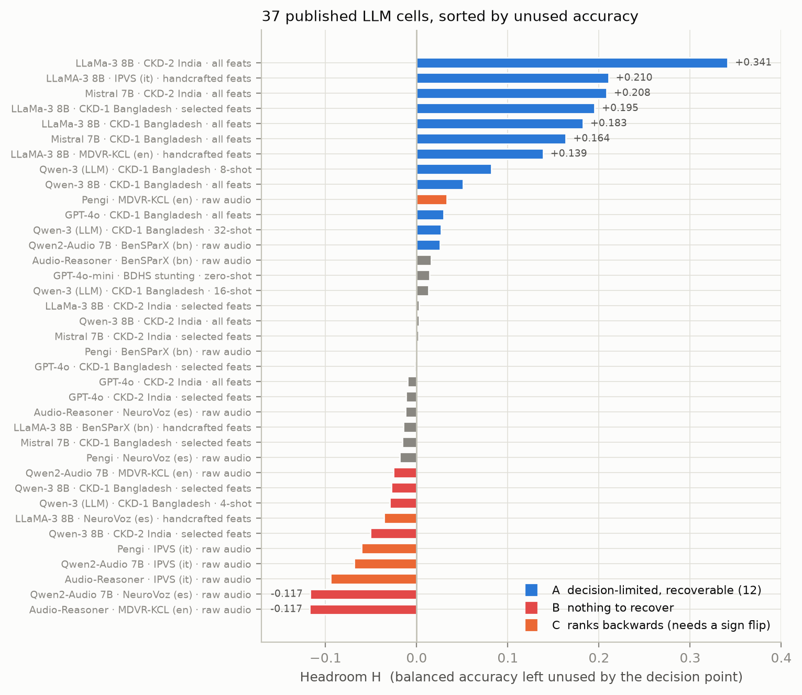

# Most Zero-Shot Clinical LLM Evaluations Cannot Be Checked, and a Third of Those That Can Are Decision-Point Artifacts

**Type:** short report / methods note.
**Version:** short-form v1, 2026-10-15.
**Relationship to the long form:** this is the submission version. The full
manuscript, with every experiment, ablation, correction and retraction, is kept
at `draft_paper.md` and is intended as supplementary material or a preprint.
Nothing is claimed here that is not supported there.

---

## Abstract

Papers that test large language models as zero-shot clinical screeners usually
report two kinds of number: how well the model **ranks** patients (AUROC), and
how well its **yes/no call** performs (balanced accuracy, sensitivity,
specificity). These measure different things. A model can rank patients well and
still decide badly, if the line between "yes" and "no" sits in the wrong place.

We make two observations.

**First, and most important: much of this literature cannot be checked for this
problem at all.** In a screen of five recent papers, **three report no
threshold-dependent metric** — AUROC and nothing else. For those papers no
reader, including a reviewer, can tell whether a reported result reflects the
model or the decision point. One further paper was behind a paywall.

**Second, where the check is possible, it often fails.** Across **37 result
cells from 4 papers** that report both metric families, **12 (32.4%)** show a
reported failure that is consistent with a misplaced decision point rather than
a weak model, with a mean of **0.138** balanced accuracy left unused. The
clearest case is printed in a published table: a model ranking kidney-disease
patients at **AUROC 0.923** and reported at **balanced accuracy 0.502**, the two
numbers side by side without comment.

We give a diagnostic that needs only those two already-printed numbers and no
labels, show by simulation when it is wrong and in which direction, and confirm
prospectively on images and speech that what it predicts is what you actually
get when you move the decision point. We claim no new mathematics: the estimate
is standard signal detection theory. The contribution is the measurement, the
reporting finding, and a concrete recommendation for what such papers should
print.

---

## 1. The problem

Zero-shot clinical LLM work follows a common recipe. Serialise a patient's
features into a prompt, ask the model to answer 1 or 0, score the answer. The
token the model emits is **one operating point**: it is the sign of an
underlying score. For a forced single token with logprobs, the score is

```
s = log P("1") - log P("0")
```

and the emitted token is exactly `s > 0`. That zero is a default. It is not
chosen for the task, the prevalence, or the cost of a miss.

So when such a paper reports a poor balanced accuracy, there are two very
different explanations:

- **the model cannot separate patients** — a ranking problem, and the honest
  conclusion is that zero-shot does not work here; or
- **the model separates patients but the line is in the wrong place** — a
  decision problem, fixable with a handful of labels and no retraining.

These call for opposite responses. Telling them apart needs both metric
families. That is the whole of our point.

### Why it matters

The conclusions drawn in this literature are strong and practical — "zero-shot
capability alone is insufficient" — and they are increasingly aimed at
low-resource clinical settings, where a screening tool that needs no training
data is most attractive. If a third of the reported failures are decision-point
artifacts, some of those conclusions are too pessimistic, and a usable tool is
being discarded.

---

## 2. The diagnostic

Under the standard binormal model of signal detection theory, AUROC fixes the
separation between the two score distributions, and the best balanced accuracy
any threshold could reach follows directly:

```
d'        = sqrt(2) * Phi^-1(AUROC)
reachable = Phi(d' / 2)
H         = reachable - BACC_reported
```

`H` is the **headroom**: balanced accuracy left unused by where the line sits.
All three quantities come from two numbers a paper already prints. No labels, no
model access, no data.

**The direction matters.** We use AUROC as reported, never `max(AUROC, 1-AUROC)`.
An earlier version of our own code took the flipped value and produced phantom
headroom of +0.237 and +0.248 on two endpoints that actually ranked patients
backwards. That bug and its fix are documented in the long form.

Three failure modes follow:

| mode | condition | reading |
|---|---|---|
| **A** decision-limited | AUROC > 0.5, H > 0.02 | ranking is usable; the line is wrong |
| **B** signal-limited | AUROC > 0.5, H <= 0.02 | the model genuinely cannot separate |
| **C** sign-inverted | AUROC < 0.5 | ranks backwards; needs a sign flip, not a shift |

The intervention for mode A is the cheapest one available: fit the threshold on
a few labelled cases, change nothing else.

### When the estimator is wrong

The formula is exact only when the two score distributions are Gaussian with
equal variance. We tested it by simulation against twelve non-Gaussian
conditions. It was **conservative in eleven of them** — it under-states the
reachable value, so H is a lower bound in those cases. Error grows with unequal
variance in a U shape (roughly -0.04 at a 2:1 SD ratio, -0.15 at 6:1) and is
-0.051 for saturated or clipped scores, which is directly relevant because LLM
logprobs saturate.

**It is not conservative everywhere.** With bimodal *negative* scores the
estimate was too high by +0.0029 (SE 0.0009). So `reachable` is an estimate
under a model, **never a guaranteed upper bound**, and we do not describe it as
one.

---

## 3. Finding 1: most of this literature cannot be audited

This is the finding we consider most robust, because it does not depend on our
estimator being correct. It is a statement about what papers print.

We screened five recent zero-shot clinical LLM papers prospectively, against a
pre-set criterion: does the paper report, for at least one (model, dataset)
combination, **both** a ranking metric and a threshold-dependent metric?

| paper | metrics reported | auditable? |
|---|---|---|
| Child malnutrition, BDHS [9] | BACC, AUROC, sens, spec | **yes** |
| Knowledge-injection delirium [10] | AUROC only | **no** |
| AgentRx [11] | AUROC, AUPRC, ECE | **no** |
| ClinicRealm [12] | AUROC, AUPRC | **no** |
| Pediatric wrist fracture [13] | unknown | **not accessible** (paywall) |

**Three of five report no threshold-dependent metric.** For these, the question
this paper asks cannot be answered by anyone — not by us, not by a reviewer, not
by the authors' own readers.

Two details sharpen the point:

- The delirium paper's methods section says accuracy, precision, recall and F1
  "were additionally computed", but **none of them is printed**. It also
  mentions a fixed threshold of 50 — so a decision point exists, is applied, and
  is never evaluated.
- ClinicRealm's eligibility was verified from the PDF text rather than the
  abstract. Its mention of a confusion matrix concerns reasoning error types,
  not classification.

This has a direct consequence for our own headline, and we state it rather than
hide it: **our audited sample is drawn from the minority of papers that report
both metric families.** Papers reporting only AUROC may differ systematically,
in a direction we cannot determine.

### What we recommend reporting

TRIPOD+AI [14] is the current reporting standard for clinical prediction models
and supersedes TRIPOD 2015. The metrics our check needs are metrics such papers
are already expected to report. (We did not retrieve the individual checklist
items, so we make no claim about which specific item is at issue.)

Our concrete ask is small and costs nothing:

1. Report **both** a ranking metric and at least one threshold-dependent metric,
   for every cell, not only in aggregate.
2. State **where the decision threshold came from** — a default, a fixed value,
   or one tuned on data — and say which data if tuned.
3. Where scores exist, release them, or release enough of the ROC to let a
   reader see the shape. One ROC point is not a score distribution.

Point 3 is also the limit on our own work: **no paper we audited releases
score-level outputs**, so every published-paper result in this report is an
estimate, and we could not demonstrate recovery on anyone else's system.

---

## 4. Finding 2: where the check is possible, a third of cells fail it

A cell enters the audit if the paper reports, for one (model, dataset, setting)
combination, both AUROC and a threshold-dependent metric from which balanced
accuracy can be read or computed exactly. Everything is transcribed as printed;
nothing is inferred or imputed. Of the cells collected, **0 required balanced
accuracy to be derived**, and among cells printing sensitivity, specificity and
balanced accuracy there were **0 inconsistencies**.

The primary analysis uses **37 published LLM cells from 4 papers**.

| mode | count | share |
|---|---|---|
| **A** decision-limited | **12** | **32.4%** |
| **B** signal-limited | 20 | 54.1% |
| **C** sign-inverted | 5 | 13.5% |

Mean recoverable balanced accuracy in mode A: **+0.138**.

**The clearest single case.** LLaMa-3 8B on CKD-2 (India): **AUROC 0.923**,
reported balanced accuracy **0.502**, estimated reachable **0.843**, so
**H = +0.341**. Macro F1 is 27.68. The paper prints the ranking and the decision
metric adjacent to each other and does not comment on the gap. A model that
ranks patients that well is not a useless model.



**Figure 1.** The 37 primary published LLM cells sorted by headroom. Blue bars
are the 12 decision-limited cells. Orange bars rank patients backwards: moving
the threshold does not help them, flipping the sign would. Grey and red bars
have nothing to recover.

### How much to trust 32.4%

We report the uncertainty honestly, because the sample is small and clustered.

- Cells from one paper are **not independent**. A bootstrap over papers rather
  than cells gives **32.7%, 95% CI [17.6%, 46.2%]**.
- **Per-paper rates range from 0% to 50%** (0.0%, 18.8%, 43.8%, 50.0%). One
  paper contributes no decision-limited cells at all. This heterogeneity is
  real and is the main limit on the claim.
- The 0.02 cut-off is a choice. Moving it, **without re-tuning anything**:

| H cut-off | share in mode A |
|---|---|
| > 0.00 | 51.4% |
| > 0.01 | 40.5% |
| **> 0.02** | **32.4%** |
| > 0.05 | 24.3% |
| > 0.10 | 18.9% |

The headline therefore reads: **in this sample of 37 cells from 4 papers, 32.4%
are decision-limited**, with a paper-level interval of [17.6%, 46.2%] and a
cut-off sensitivity from 51% to 19%. We do not generalise it to the field.

### A published conclusion is confounded, not refuted

One audited paper concludes that feature selection improves its LLM screener.
Across its 8 (model, dataset) pairs, we find that in **3 of 8** a threshold fix
applied to the *all-feature* scores beats the reported *selected-feature* result
— for LLaMa-3 on CKD-2, 0.843 against the reported 0.764. In **2 of 8**,
selection made the ranking worse while balanced accuracy rose. In **5 of 8** the
ranking genuinely improved.

We state this as **confounded, not refuted**: part of what is attributed to
better features is a decision-point effect. Shown entirely from that paper's own
published table.

### Within-paper heterogeneity, in the subgroups that matter

The malnutrition paper's overall cell is signal-limited (AUROC 0.632, BACC
0.580, H +0.014). But it also prints 14 subgroup rows, and **6 of them are
decision-limited**. The two worst are the poorest wealth quintiles:

| subgroup | AUROC | BACC | sens | spec | H |
|---|---|---|---|---|---|
| Wealth: poorest | 0.581 | 0.500 | **1.000** | **0.000** | +0.057 |
| Wealth: poorer | 0.560 | 0.509 | 0.987 | 0.030 | +0.034 |

Sensitivity 1.000 with specificity 0.000 means the model said "yes" to everyone
in that group. These 14 rows partition the **same 17,106 evaluations**, so they
are not independent and are **excluded from the primary statistic**. We report
them as within-paper heterogeneity, and note the equity implication: in this
paper the artifact concentrates in the poorest patients.

---

## 5. Finding 3: the prediction holds up prospectively

An audit over published tables is arithmetic. To show the estimate predicts
something real, we tested it forward on data we control, in three modalities.

**Images (8 endpoints, frozen BiomedCLIP features).** Predicted headroom against
realised gain from fitting a threshold on k labels:

| budget | form | Pearson | Spearman | perm p |
|---|---|---|---|---|
| k = 8 | H vs gain | +0.914 | +1.000 | 0.0000 |
| k = 8 | reachable vs achieved (no shared term) | +0.855 | +0.762 | 0.0368 |
| k = 64 | H vs gain | +0.960 | +0.976 | 0.0004 |
| k = 64 | reachable vs achieved (no shared term) | +0.955 | +0.905 | 0.0046 |

H and the realised gain both contain `-BACC_native` on the same split, so part
of that correlation is mechanical. The **level form shares no term** and the
relationship survives it. **Sign agreement was perfect**: all 4 endpoints with
H > +0.02 gained; all 4 with H <= +0.02 did not.

**Speech (BenSParX, Bengali, local LLaMA-3.2 3B, 40 subjects).** The model's
native decision was degenerate — **sensitivity 1.000, specificity 0.000,
balanced accuracy 0.500** — while its scores ranked subjects at **AUROC 0.805**.
Predicted headroom **+0.228**; realised **+0.232** with 16 labelled subjects
(0.732). The subject-level interval at k = 16 is [0.612, 0.879], so the close
agreement is not precision to three decimals, and we do not present it as such.

**Tabular CKD (400 records, 40 patients).** Degenerate again — sensitivity
1.000, specificity 0.000 — a third modality showing the same failure. But
**every confidence interval includes chance** (patient-level AUROC 0.590
[0.404, 0.767]). We therefore report this arm as **inconclusive** and do **not**
count it among our demonstrated cases.

Across all three, the pattern that keeps appearing is the degenerate one: the
model says "yes" to everyone, balanced accuracy lands at exactly 0.500, and the
ranking underneath is not 0.500 at all.

---

## 6. What we are not claiming

- **No new mathematics.** The AUROC-to-reachable-accuracy link is Green and
  Swets (1966) [8], used unchanged.
- **No new threshold method.** Youden's J, cost-weighted and prevalence-adjusted
  cut-offs are mature. Our point is that this literature does not apply them.
- **Not calibration.** Calibration fixes the probabilities; we ask a narrower
  question, which is how much is lost by one fixed line given the scores as they
  are. A model can be well calibrated and still decide badly.
- **Not conformal prediction or selective classification.** Those also set
  operating points, but they **abstain** rather than **relocate**, and they need
  a labelled calibration set and access to the model. Our diagnostic needs two
  numbers already printed in a paper. That difference is what makes a
  retrospective audit possible at all.
- **No causal claim.** We compare published results observationally. We cannot
  exclude that our estimator is simply wrong for those papers' score shapes,
  that an operating point was chosen deliberately, or that a selection effect of
  unknown direction is at work.
- **No universal claim.** Nothing here says all clinical LLM failures are
  threshold artifacts. The number applies to the audited sample.

---

## 7. Limitations

**The audit is small, clustered and heterogeneous.** 37 cells, 4 papers,
per-paper rate 0% to 50%. This is the main weakness of the paper and the reason
we lead with the reporting finding instead of the rate.

**Our search was targeted, not systematic.** No registered protocol, no dual
screening. `audit/SEARCH_LOG.md` records every search and fetch, including the
failures. A systematic review-scale audit is the obvious next step.

**All published-paper results are estimates, not demonstrations.** No eligible
paper releases score-level outputs or per-case predictions, and a sensitivity /
specificity pair gives one ROC point, not a score distribution. We requested
nothing from authors; that is the route to a demonstration.

**The forward test is small too.** 8 image endpoints across 4 label columns, one
speech dataset, one inconclusive tabular dataset. Endpoints within a label
column are nested cut-points and not independent. On the `primary` subset only
3 endpoints remain, which cannot reach significance (permutation p = 0.33); we
report that as underpowered, not as a negative result.

**One paper was inaccessible** (paywall, no open version located), so the
screen of five is really a screen of five with one unknown.

**Journal quartile claims are unverified.** SCImago returned HTTP 403 on every
attempt during preparation, so any quartile figure in our notes comes from
search snippets and aggregators and must be confirmed before use.

---

## 8. Corrections

This report inherits several corrections from the long form, which we list
because they affect how much weight the results deserve:

- A **sign-agnostic AUROC bug** in our own diagnostic produced phantom headroom
  on two endpoints. Fixed; results recomputed.
- A **miscount** in an earlier manuscript ("6 of 43 cells" where the true figure
  was 21 of 43) was corrected.
- **Two findings were retracted** after we discovered the linear-probe baseline
  was unfairly configured (no class weighting). With `class_weight="balanced"`,
  the claimed degeneracy disappeared entirely.
- **Our own proposed method** (matching the predicted positive rate to an
  estimated prevalence) was **refuted by our own experiments** and abandoned:
  given the true prevalence it won on only 4 of 9 endpoints, and estimating
  prevalence from k labels lost to direct threshold fitting at every budget.
- A **sampling bug** was caught by a cheap pre-check before the expensive run.
  It labelled each patient by their first visit, and no patient in that cohort
  is positive at visit 1, so the balancing silently did nothing. Had the full
  run launched without the pre-check, that arm would have been invalid.

All numeric claims in this report are checked automatically against the result
files by `src/check_claims.py` (**75 claims, 0 failures**).

---

## 9. Data and code availability

All data used are public: BenSParX (MIT licence), MedIMeta cached features, and
a Mendeley diabetic-CKD dataset. No private or identifiable data were used. Code,
result files, figure scripts, the audit trail, the search log including failed
searches, and the preserved earlier manuscript versions accompany this
submission. The extraction protocol for published cells is in
`audit/EXTRACTION_PROTOCOL.md`.

**Documented failures**, kept deliberately: SCImago HTTP 403; a Nature paywall
on one candidate paper; one journal full text (JMIR Formative Research 2026;
e86379) that we could not retrieve and therefore cite as related work **without
using any number from it**.

---

## 10. References

[1] LLM4CKD. arXiv:2609.04013. (Audited.)
[2] From Many to Meaningful: feature selection for zero-shot CKD screening.
    arXiv:2607.12260. (Audited.)
[3] Zero-Shot Parkinson's Disease Detection from Speech. arXiv:2605.24806.
    (Audited.)
[4] BenSParX: a Bengali speech dataset for Parkinson's disease.
    arXiv:2505.12192. (Data, MIT.)
[5] MedIMeta: a medical imaging meta-dataset. (Data.)
[6] Diabetic CKD progression dataset. Mendeley Data,
    doi:10.17632/hjkzgbxgv5.2. (Data.)
[8] D. M. Green, J. A. Swets. Signal Detection Theory and Psychophysics, 1966.
[9] Can Zero-Shot LLMs Predict Child Malnutrition? A Fairness and Temporal
    Robustness Study. arXiv:2607.29082. (Audited; Table 4.)
[10] A Knowledge-Injection Framework for Zero-Shot Adaptation of LLMs to
    Delirium Prediction. arXiv:2607.20453. (Examined; AUROC only.)
[11] AgentRx. arXiv:2605.10286. (Examined; no threshold metric.)
[12] ClinicRealm. arXiv:2407.18525. (Examined; no threshold metric.)
[13] Pediatric wrist fracture detection with zero-shot MLLMs. Scientific
     Reports s41598-026-58763-w. (Not accessible.)
[14] G. S. Collins et al. TRIPOD+AI statement. BMJ 2024;385:e078378.
     (Erratum BMJ 2024;385:q902.)
[15] Beyond AUROC: evaluating models under class imbalance in real-world
     clinical data. JMIR Formative Research 2026;e86379. (Related work; full
     text not retrievable, no number used.)

---

## 11. Supplementary material

The long-form manuscript `draft_paper.md` contains, in full: the aggregation
experiment (averaging scores against majority voting), the label-budget
comparison, the feature-saturation analysis, the estimator characterisation
across all twelve conditions, the complete error analysis and ablations, the
threats-to-validity section, and the full corrections and retractions record.
